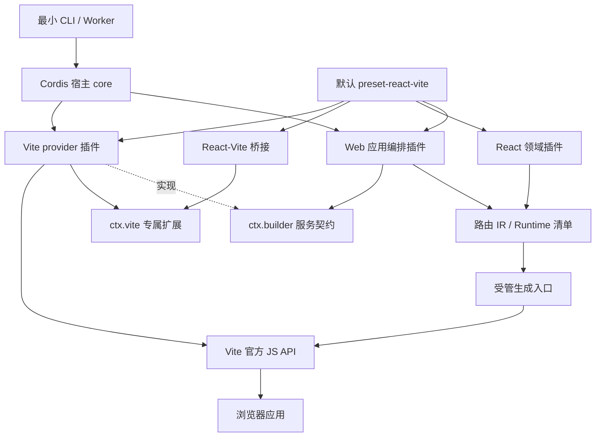

# Cormi 框架架构设计草案

版本：Draft 0.20。修订轮次：P9（插件样式、静态资源与独立消费验证）。

**本文是待验证的设计方案，不是已经实现的功能说明。** 框架名称为 cormi；cormijs 仅用于发布包名和 @cormijs 命名空间。未实现的接口仍是拟议协议，不表示 npm 包已发布。上游事实及固定提交见 [源码研究](01-source-study.md)，实施与验证顺序见 [MVP 计划](03-mvp-plan.md)。

P0/P1a/P1b 保留各自历史结果。P1c 在 React/路由基础上增加受管 staging 与产物替换、路由类型、生成清单及应用 inspect/typecheck。精确协议见 [发布和检查](10-publication-and-tools.md)，已测范围见 [P1c 结果](11-p1c-results.md)。下面的完整编译阶段、完整诊断图与跨平台发布仍含目标设计，不能推定整份草案已经实现。

P2a 增加开发态编译恢复：PreparedApplication.development 提供状态，Web 命令通过后端无关契约转发，Vite 才实现 WebSocket 和浏览器面板。首次可修复错误保留开发服务但不伪造成功输出；一次性 build/prepare/typecheck 仍失败退出。监听就绪与应用编译状态分离，详见 [开发恢复协议](12-development-recovery.md)。

P3a 增加真实 tarball 与仓库外消费者验收。Node 包提供明确 engines，dist 的 sourcemap 对应 src 一并入包；默认 preset 的公开类型使用 Preset，不泄漏未声明的传递类型依赖。Cordis 原始运行时仍不变，本地试用选择消费者根显式 pnpm 声明补丁，不复制或改名上游 Context；无补丁透明公共安装仍是发布限制。详见 [打包消费协议](15-package-consumers.md)。

P3b 将 Linux 验证作为仓库开发工具提供，不向 core 或默认 preset 加入 Docker 依赖。受限源码快照进入非 root 容器的原生文件系统；在线准备依赖后断开外部网络，执行同一套类型、Node、浏览器和真实包消费测试。通过范围以具体平台和版本记录为准，不能扩张为 Windows、全部 Linux 或生产部署保证。见 [Linux 协议](17-linux-validation.md) 与 [结果](18-p3b-results.md)。

P3c-prep 区分平台逻辑准备与 Windows 原生证据。Launcher 为已建立 IPC 的父进程提供协作关闭消息，不将 Windows kill 信号当作 Unix 优雅退出；pnpm 自动化优先使用原生 Node argv。Windows 契约入口在非 Windows 明确拒绝且不运行用例，完整平台验收仍待实际 Windows 目标。见 [Windows 验证协议](19-windows-validation.md)。

P4a 回到应用功能主线，Windows 原生验收按用户决定挂起。React 功能插件可声明自己的客户端模块、路由 meta 与 runtime；显式 from 通过 clientModule 绑定作者位置。defineReactFeature 只生成原生 Cordis 插件，useRouteMatches 读取浏览器路由元数据。精确接口及可运行例子见 [功能插件协议](21-react-features.md)，不要继续把旧章节中的目标接口当成唯一的当前 API。

P4b 增加独立项目创建器与显式开发 API 插件。create-cormi 不依赖目标项目配置或 Cordis 宿主，用本地 kit 生成可重定位应用；Mock/代理主入口为 Node HTTP handler，/vite 桥接才注入 Vite 服务，默认 preset 不强制安装。开发接口不进入 build/preview，详见 [创建与 API 协议](23-project-creation-and-dev-api.md)。

P4c 增加可选 applicationConfigPlugin 及通用命令 middleware。加载器记录 preset/user 的赋值来源；应用插件执行冻结快照的 deriveConfig；config --for 重新解释当前目标命令输入，inspect 保持上次成功生成快照。core 仅定义数据与命令协议，不吸收 Web 默认值或派生策略。报告不含 Vite 内部默认值或私有 plugin options，见 [配置来源协议](25-configuration-provenance.md)。下一步转入 [真实 Admin 迁移](26-admin-migration.md)。

P5b 由真实 Admin 迁移补充 RouteRecord.errorBoundary、eager 错误组件生成、lazy 导入异常的保真转交、显式 StrictMode 和挂载元素占用检查。能力位于 routes、React compiler 和浏览器 runtime，core 不依赖模板/UI。默认行为和失败范围见 [边界协议](29-routing-boundaries.md)，真实接缝见 [AM02/AM09](admin/04-routing-migration.md)；根路径首组通过不等于 AM10 子路径及全部业务交互完成。

P5c 将部署基址的一致性落在实际Vite provider：原生config hook不能改变已生成应用计划的base，修改基址应通过app配置或派生。Admin动态public资源由应用本地工具适配，不向core增加MUI或模板路径知识。资源字节、根/子路径、状态HMR与失败构建的验证契约见 [Admin部署协议](31-admin-deployment-and-development.md)，实际结果单独记录。

P5d将真实模板Header可访问交互作为显式可选上游修正，不改变core、runtime或默认preset；图表使用原组件验证交互、尺寸和有限卸载循环。原版/忠实迁移/改进副本分别保留自己的契约与差异，见 [Header与图表](33-admin-header-and-charts.md)。模板修复不是新增框架能力，当前样本通过也不是整个可访问性或长期资源审计完成。

P5e 按用户明确的主线，将 Admin 作为功能测试负载，不再扩展模板 UI/业务修复。Supervisor 在旧 worker 清理完成与新 server 就绪前校验当前输入，防止连续配置修改激活已过期候选或误报 ready；一次性命令不重放。能力与边界见 [框架验收矩阵](35-framework-validation.md)。

P6 将开发HTTP规则扩展为DevApiService，通过原生Cordis Service追踪调用者并在服务内部绑定effect；独立Vite bridge消费服务，旧组合入口由原生子插件构成。同一测试包的Node/client入口分别交付并经过tgz安装验收。没有向core增加路由注册器或引入Vue控制台；参考源码、不同Cordis版本及许可声明见 [生态协议](37-cordis-ecosystem.md)。动态注册不等于任意Node源码进程内HMR，错误/取消/资源排空仍由领域实现验证。

P7 增加 ProjectRuntime.graph() 的实际Cordis状态观察、可选DiagnosticService和保留启动诊断命令diagnose。应用依赖不能就绪时仍输出结构化快照并非零退出；目标命令不执行，服务value/私有options不进入报告。配置来源、当前插件快照、旧生成结果分别由config、diagnose、inspect表达，不把新worker观察冒充运行中dev状态。实现边界见 [插件诊断协议](39-plugin-diagnostics.md)，实际回归另见 [P7结果](40-p7-results.md)。

P8将Node/client配对方式交付为现有创建器的plugin-react模板：原生Cordis子插件组合、独立exports、作者专用源码桥接以及源码快照编译后的tgz。不把作者工具、Vite别名或本地框架归档带给消费者，不修改core生命周期；库dist与示例app-dist分离。实际公开入口和未支持资源范围见 [插件作者指南](41-plugin-authoring.md)。

P9在插件作者模板中提供有界资源快照、普通库构建复制和全新打包目录，保持CSS/图片/字体的相对模块布局；消费后端负责实际资源转换与base。没有向core新增资源服务器、修改Cordis生命周期或全局关闭Vite依赖优化。普通库dist不承诺跨文件事务，具体资源所有权、失败与分发限制见 [资源协议](43-plugin-assets.md)，实际结果见 [P9记录](44-p9-results.md)。

## 1. 应该做一个什么框架

建议把 Cormi 定位为：**以 Cordis 作为最小插件宿主，由可替换的应用编排插件装配应用，由默认 React + Vite preset 提供开箱即用体验的应用框架。** 默认技术栈属于产品组合，不属于内核硬依赖。

它不是 Umi 的改名版本，也不是把 `api.register()` 替换为 `ctx.on()`。对用户而言，应当具有类似 Umi 的约定、配置、路由与 preset 体验；对插件作者而言，应当提供明确的服务依赖、资源归属、编译扩展点和调试信息。

首个适用场景是业务型 React SPA：有多页面路由、公共布局、开发代理、环境配置和少量项目级插件。它应当比“每个项目复制一份 Vite 配置与启动模板”更容易统一维护，但不以兼容 Umi 全生态或挑战所有前端框架为第一目标。

最值得验证的价值是：**一套功能可以作为 preset 交付，插件能够声明自己依赖什么、贡献什么、退出时清理什么，编译结果可以解释来源。** 仅仅更换 DI 库，不构成足够的框架差异。

## 2. 首版边界与技术选择

| 维度 | Draft 0.6 决策 | 原因 |
| --- | --- | --- |
| 应用模式 | React SPA，客户端渲染 | 先把路由、构建和扩展协议做完整 |
| Node 插件内核 | Cordis，隔离具体版本适配 | 复用 Context、服务注入和 Fiber 生命周期 |
| 浏览器路由 | React Router Data Mode | 直接使用路由库，不再叠加其完整 Framework Mode |
| 构建后端 | 独立 Cordis provider 插件，首版实现 Vite | 内核只认契约；Vite 原生接口留在专属插件内 |
| 开发语言 | TypeScript，ESM 优先 | 保持插件类型扩展与模块边界清晰 |
| 应用配置 | `cormi.config.ts` | 不要求用户理解 Cordis loader/YAML 协议 |
| Node 端源码更新 | 重启 worker | 先保证传递依赖更新与资源释放正确 |
| 浏览器更新 | Vite + React 集成插件 | 不把 Cordis 插件重载当作 Fast Refresh |
| 类型检查 | 独立 `typecheck`，CI 必跑 | 代码转译成功不等于 TypeScript 检查通过 |

React Router 的 Data Mode 使用 `createBrowserRouter` 与 `RouterProvider`；Vite 提供 `createServer / build / preview` 等 JS 接口。[官方路由说明](https://reactrouter.com/start/data/installation)、[Vite JS API](https://vite.dev/guide/api-javascript.html)。这些是集成基础，不意味着 Cormi 已完成适配。

MVP 不包含 SSR、SSG、RSC、微前端、MFSU、多个 bundler、Vue preset、远程插件市场、Umi API 兼容层或任意插件源码的进程内热替换。未来是否加入，取决于真实使用场景，而不是把 Umi 的功能列表全部复制成待办。

本次 Cordis 源码为 `4.0.0-rc.11`，不能把 RC 当作稳定性承诺。P0 必须选择可复现的精确依赖版本或固定源码构建产物，记录锁文件，不直接使用漂移的 `latest` 或跨 RC 范围。Node 候选基线为 22.12 及以上的受支持版本，但最终 engines 与测试矩阵必须按实际锁定的 Vite、React Router、Cordis 版本交集确定，不能沿用 Umi 根包中的旧 Node 下限。[Vite 环境要求](https://vite.dev/guide/)

## 3. 三层职责，而不是一个巨大的 Context


**第一层是 Node 插件宿主。** Cordis 决定插件何时激活、服务如何注入、插件卸载时清理哪些受管资源。Cormi 只封装少量版本适配和错误诊断，不重新实现一套插件生死状态机。

**第二层是应用编译流程。** P1b 的 `plugin-web` 提供命令编排、回调排序和受管提交原语，消费可替换的 application 编译服务；React 领域插件实现页面/运行时装配并提供该服务。编译顺序、快照、取消和提交不是 DI 容器的职责，更不是 core 不可替换的固有阶段。

**第三层是浏览器运行时。** 它只包含 React、Router 和应用需要的 runtime 插件。不运行 Node 插件，不接收 Cordis Context，不携带构建器、文件系统访问或 Node 配置对象。

分层依据来自 Cordis 的 Context/Fiber 实现，以及 Umi 的 Service、临时文件生成和浏览器 renderer 的分离方式，见 [源码研究 §2–3](01-source-study.md)。

## 4. 工程组织与公共边界

按真实职责建立边界，不要求每个 service 单独发布。P0/P1a 实现基础宿主与启动，P1b 加入下列路由和 React 包；所有包目前仍为 private。

```text
packages/
├── core/                    # Cordis 宿主、就绪检查、诊断和命令协议；无 React/Vite
├── builder/                 # 构建/会话/开发失效契约；无 Vite 类型
├── routes/                  # 路由 IR、扫描、验证；无 React/Vite
├── plugin-web/              # 命令编排、OrderedHooks、受管生成队列
├── plugin-vite/             # builder 与 vite 的具体 provider
├── plugin-react/            # application 编译服务、react 贡献；无 Vite
├── plugin-react-vite/       # React 专属 Vite 集成
├── preset-react-vite/       # 显式默认组合
├── runtime/                 # 仅浏览器 React/Router 生命周期
└── cormi/                   # CLI 和配置入口；发布包名 cormijs
```
pnpm workspace 仅纳入 `packages/*`、`examples/*`，不纳入 `cordis/`、`umi/`。P0 源码与构建产物需可实际运行，不为图上的每个包建空壳。公共入口隔离 Node 与浏览器依赖图；不得以一个 barrel 同时 re-export core 和 runtime。

`plugin-vite` 从第一个实现开始就是独立 provider，而不是等第二个构建器出现后才移出 core。通用契约只覆盖已需要的输入、结果和会话关闭；Vite 原生配置/插件通过后端专属 SDK 暴露，不伪装成跨后端能力。需要第二个真实后端时检验契约，不预先设计覆盖全部 bundler 的万能配置。

## 5. 项目实例、服务与资源所有权

P1a CLI 已在配置求值前用 `.cormi.lock` 独占项目，包括 preview 与自定义命令，因为它们也写私有配置缓存。当前不自动回收 stale 锁。直接 ProjectRuntime/builder 低层 API 不自动获得 CLI 写锁。

每个 `ProjectRuntime` 对应一个项目根目录、命令、mode 和独立 Context。配置、路由贡献、诊断和 watcher 都归实例所有；不得在模块顶层存放可变的项目配置、运行中的 server 或全局路由表。

同一项目根的生成目录采用跨进程独占锁：dev 持锁直到退出，build/typecheck 等写入命令在锁被占用时明确报告 `PROJECT_BUSY`，不并行改写 `.cormi`。不同项目可以独立运行。同项目并发 dev/build 暂不进入 MVP；将来要支持，必须先按会话或目标隔离生成目录与 HTML 入口解析，单纯分成两个 worker 不能解决共享文件竞态。锁所有权需要可核验的进程/会话身份，不能仅凭旧 PID 或超时就删除另一存活进程的锁。inspect 默认读取最后一次成功 manifest，不额外启动写入流程。

| 服务/模块 | 职责 | 不负责什么 |
| --- | --- | --- |
| Project | 规范化根目录、路径、命令、mode | 不在任意时候修改 `process.cwd()` |
| Config | bootstrap 配置、schema、有效配置快照 | 不把整个环境变量对象输出给浏览器 |
| Pipeline | 编译扩展点、排序、快照、执行诊断 | 不取代 Cordis 的插件生命周期 |
| Routes | 扫描结果、路由 IR、冲突检查 | 不在 Node 中 import 页面组件执行 |
| Runtime | 浏览器模块引用及公开 options | 不传递 Node 对象或函数闭包 |
| Artifacts | 受控生成、hash 比较、提交与清理 | 不开放任意文件覆盖能力 |
| Builder 契约 / Vite provider | 通用 dev/build/preview 契约与具体实现分离 | core 和消费者不接触 Vite 类型或 server |
| Diagnostics | 插件来源、阶段耗时、错误链、失效原因 | 不默认打印密钥和完整环境 |

归属原则是“创建者负责释放，消费者通过声明依赖延长服务有效期”。一个监听器、定时器、watcher、端口或后台编译任务都必须能追溯到 owner。插件卸载不等于删除用户源码；退出只撤销注册和受管资源，不能猜测并清理用户工作成果。

Cordis 已有依赖消费者清理顺序，但同一 Fiber 的独立 disposer 不保证全局串行执行。要求顺序的清理逻辑必须由同一 owner 显式 await，例如先阻止新编译、再等待现有编译结束、再关闭 server。清理异常不能只落在 Cordis 日志中就对 CLI 报告“干净退出”；宿主需要收集诊断并标记不完整退出。具体源码见 [源码研究 C3/C6](01-source-study.md)。

## 6. 启动过程：依赖就绪与编译就绪分开

宿主只负责挂载、就绪与销毁；下面的配置检查和编译阶段由默认 Web 应用组合执行，不是 core 内置的 Web 流程，也不依赖某个插件恰好先运行。

1. **Bootstrap。** 确定 root、command、mode，读取配置入口及 preset/plugin 描述。解析模块本身会执行受信任代码，因此这不是安全沙箱。收集静态可知的本地依赖文件。
2. **描述与配置检查。** 展开 preset，检查插件实例 ID、显式服务声明与明显的循环依赖；收集 schema、默认值并验证 options。执行这一阶段不应启动网络监听或文件 watcher。
3. **安装基础服务与插件。** 建立 Context，挂载基础服务，再注册整个插件集合。不要在尚未注册 provider 时逐个等待 consumer；不要让父插件提供服务同时等待依赖该服务的子插件完成启动。
4. **就绪屏障。** 等待已知初始化任务，重新检查所有必需插件确实进入 ACTIVE。PENDING 要报告缺失服务，FAILED 要报告原始错误，异步未完成要有超时。预检无法识别的动态依赖由这一层兜底。
5. **封闭注册与编译。** 冻结当前贡献清单，检查本轮输入，生成入口与类型，再启动 dev 或 build。运行中注册的新贡献只能触发下一轮编译，不能改变当前执行快照。

Cordis v4 的 `await ctx.plugin()` 主要等待当前 Fiber 的活动任务；源码中 PENDING 且没有 inertia 的 Fiber 也可能返回。不能把它误写成“所有依赖必然已准备好”。就绪判断是 Cormi 适配层最先要做的 P0 实验，见 [源码研究 §2.2](01-source-study.md)。

插件初始化本身应短小：声明服务、登记编译回调、建立受管资源。耗时的目录扫描、路由计算和代码生成进入显式编译阶段，避免把应用构建隐含在服务构造函数里。

## 7. 插件协议：原生生命周期，小型领域 SDK

本节保留领域 SDK 的目标示例，不是当前完整可编译 API。P1b 路由与 runtime 贡献通过 `ctx.react.routes/runtime` 的 OrderedHooks 注册；相对 ModuleRef 目前以项目根为基准，preset-react-vite 导出的是 preset 对象而非工厂。精确使用方式见 [当前协议](08-routes-and-react.md)。

建议 `definePlugin()` 接受接近 Cordis 原生插件对象的描述，增加稳定实例 ID、可诊断的 provides 元数据以及 Cormi SDK 类型。底层仍将 `apply / Config / inject` 交给 Cordis；不新增第二套 activate/deactivate 实现。

以下是**拟议接口示例，尚未编译验证**。`pipeline.tap()` 返回注销函数，必须通过 `ctx.effect()` 绑定调用者作用域。

```ts
import { definePlugin } from 'cormijs/plugin';

export default definePlugin({
  name: 'example:status-page',
  inject: ['pipeline', 'runtime'],
  apply: (ctx) => {
    ctx.effect(() => ctx.pipeline.tap('routes', {
      id: 'example:status-page:route',
      run: (routes) => [
        ...routes,
        {
          id: 'plugin:example:status-page',
          path: '/_status',
          module: {
            specifier: '@example/status-plugin/page',
            exportName: 'default',
          },
          source: { pluginId: 'example:status-page' },
        },
      ],
    }));

    ctx.effect(() => ctx.runtime.add({
      id: 'example:status-page:runtime',
      module: {
        specifier: '@example/status-plugin/runtime',
        exportName: 'default',
      },
      options: { showVersion: true },
    }));
  },
});
```

示例中的 npm 模块仅为示意。P4a 的未带 from 相对 module specifier 保留项目根语义；可复用插件使用 clientModule 显式绑定作者 file URL 并限制在作者目录子树。记录里只保存模块引用与可序列化数据，构建器最终生成静态 import；具体实现见功能插件协议。

用户配置表达功能组合，而不是把 preset 内部所有子插件平铺出来。React preset 已实现；下例是结构说明，可运行配置以 examples/features/cormi.config.ts 为准：

```ts
import { defineConfig } from 'cormijs';
import reactVite from '@cormijs/preset-react-vite';
import statusPage from './plugins/status-page';

export default defineConfig({
  presets: [reactVite],
  plugins: [{ id: 'status-page', plugin: statusPage }],
  app: { base: '/', server: { host: '127.0.0.1', port: 8000 } },
});
```

同一插件需要多实例时必须显式配置不同实例 ID；不能用函数名或 Fiber 自增 UID 作为持久身份。默认禁止同一可见域的重复服务 provider，诊断给出两处来源。需要隔离多实例服务时由显式子上下文提供，不静默覆盖。

Preset 是插件组合，不是另一套生命周期。`preset-react-vite` 组合 Web 编排、React 领域、Vite provider 与 React-Vite 桥接；不使用模糊的 React preset 暗中绑定构建器。替换 builder 时也要移除/更换依赖 `ctx.vite` 的桥接插件。两个 provider 不能静默竞争同一服务；缺少专属后端时依赖检查应明确失败。Cordis 原生嵌套插件可以承载内部组合，见 [源码研究 C9](01-source-study.md)。

## 8. 编译扩展点：类型与排序必须明确

首版不实现任意任务 DAG 调度器。下述固定阶段由 `plugin-web` 定义并执行，core 不知道这些阶段；阶段内部才为 hook 排序：

`deriveConfig → check → routes → runtime → generate → validateGenerated → commit → dev/build`

Bootstrap 配置决定插件集合与插件实例 options。`deriveConfig` 只允许调整本轮应用编译配置，不能反过来修改插件列表、root、command 或服务实例 options；修改结果需再次校验并冻结。这样不会出现“必须先启用插件才能知道是否应该启用插件”的循环。

| 执行类型 | 语义 | 错误行为 |
| --- | --- | --- |
| series | 按序执行所有回调，返回值为 void | 一个失败则停止后续业务阶段 |
| reduce | 前一个结果传给后一个，必须返回下一值 | 返回非法类型或抛错立即失败 |
| collect | 按稳定顺序合并各插件返回的贡献数组 | 冲突不静默覆盖 |
| notify | 已完成事实的观察通知 | 单独记录观察者错误，不伪造业务成功 |

`routes` 是 `RouteRecord[]` 的 reduce，runtime 模块登记最终按 collect 规则封闭，check 是 series。真正可以并行的检查使用独立受控任务组并收集全部结果，不能因为使用 `emit()` 就假定异步检查已经完成。状态型通知不得承担关键资源申请或产物写入。

排序规则建议为：先构建 hook 的显式 `before / after` 约束并检查环；拓扑排序的候选节点再按 `stage`、preset/plugin 的声明顺序及 hook ID 进行稳定选择。缺失目标默认报错，只有显式标记 optional 的顺序约束可以忽略。显式边优先于 stage，诊断应显示最终顺序及原因。

服务的 `inject` 回答“我运行时需要谁”；hook 的 `before / after` 回答“本轮变换谁先执行”。两者不能混用。Cordis 当前 waterfall 是 `next()` 中间件，不直接提供 Umi modify hook 的 memo reducer，见 [源码研究 §2.3](01-source-study.md)。

每个 hook 记录 owner、ID、阶段、开始/结束与错误 cause。开发态收到注销或新增注册时只提高 revision、触发下一轮；生产 build 在注册封闭后出现结构变更应直接失败。结果缓存先从内容 hash 和不变输入开始，不把包含函数的配置简单 JSON.stringify 后宣称可复现。

## 9. 配置加载、校验与环境隔离

配置优先级为框架默认值、preset 默认值、用户配置、显式 CLI 参数。对象按 schema 定义合并，普通数组默认替换，不采用按索引深合并；plugins/presets 则作为有身份的组合序列单独解析。`undefined` 表示未覆盖；`false` 只在明确支持关闭的项上有效；`null` 是否有效由 schema 决定。

插件 options 使用同步 Standard Schema 校验，以匹配本次 Cordis core 行为。文件存在性、端口可用性等异步检查进入 check 阶段。未知配置项报告完整路径及来源，不静默吞掉拼写错误。框架派生配置和插件的原始 options 分开保存，inspect 可对照显示但必须脱敏。

P1a 使用独立 esbuild 0.28.2 静态编译配置及项目内依赖，npm 导入保持 external，不调用 Vite loader。配置和插件顶层代码只在新 worker 求值；import.meta.url/dirname/filename 保持原始源位置。当前不支持 tsconfig paths，也不自动追踪 npm 包内部或任意动态导入，额外数据文件需显式 watch。启动后使用既有输入快照，不在 ready 后重新采样而吞掉修改，详见 [启动协议](06-naming-and-launcher.md)。

初版只接受一个权威 `cormi.config.ts`，通过 `mode` 区分环境，不同时引入多层隐藏配置文件。原生 Vite 配置属于 `plugin-vite` 的 options / 专属 SDK，而不是 core 固定认识的 `vite` 字段；由 provider 在 Vite 解析前合并。默认设置 `configFile: false` 避免暗中读取另一份 vite.config。框架保留 root、生成入口、关键 alias 与输出目录的所有权，冲突必须明确报错，不能让用户修改一半后处于不可解释状态。[Vite JS API](https://vite.dev/guide/api-javascript.html)

客户端环境变量只允许显式公开项，例如统一配置 `CORMI_PUBLIC_` 前缀。公开前缀是开发者选择暴露的声明，不是自动脱敏算法；构建日志应提醒该前缀下内容会进入客户端。绝不把 `process.env`、Node 配置对象或插件私有 options 全量放入 define。该边界需要构建产物扫描测试。[Vite 环境变量说明](https://vite.dev/guide/env-and-mode.html)

## 10. 路由：小协议、统一 IR，不执行页面源码

建议首版采用自己的有限目录约定，而不是声称完整兼容 Umi。默认扫描 `src/pages` 的 `.tsx / .jsx` 页面文件；显式 `routes` 配置存在时关闭约定式扫描，避免两个来源默认混合产生隐藏覆盖。

| 文件 | 路径/作用 |
| --- | --- |
| `index.tsx` | `/` 的 index 页面 |
| `about.tsx` | `/about` |
| `users/index.tsx` | `/users` |
| `users/[id].tsx` | `/users/:id` |
| `docs/[...rest].tsx` | `/docs/*`，捕获剩余路径 |
| `_layout.tsx` | 当前目录及后代布局，内部使用 Outlet |
| `_components/`、点目录、测试文件、声明文件 | 不进入页面扫描 |

本版不支持可选参数、路由组、并行路由、MDX、同目录双文件约定等附加语法。规则可扩展，但每增加一种规则都要补冲突与迁移测试。`users.tsx` 与 `users/index.tsx` 默认视为重复路径，而不是靠扫描顺序决定胜者；布局由 `_layout` 明确表达。

路由中间表示草案如下，页面模块只记录引用，不在 Node 端 import：

```ts
type JsonValue = null | boolean | number | string
  | JsonValue[] | { [key: string]: JsonValue };

interface ModuleRef {
  specifier: string;
  exportName: string;
}

interface RouteRecord {
  id: string;
  parentId?: string;
  path?: string;
  index?: boolean;
  module?: ModuleRef;
  source: { file?: string; pluginId?: string };
  meta?: Record<string, JsonValue>;
}
```

约定式和配置式路由都先转换为这份 IR，再运行插件 reduce，最后统一验证。要求 ID 稳定、parent 存在、父子无环、index 不带独立 path/children、catch-all 不含非法后继。`/:id` 与 `/:slug` 等同结构歧义应被识别。静态路由与参数路由可以共存，但顺序与预期匹配行为需要测试，不自研一套替代 React Router 的匹配引擎。

路由 ID 从规范化项目相对路径或显式插件 ID 派生，不使用数组下标；平台分隔符统一，但不擅自修改 URL 大小写。跨 macOS/Windows 的大小写冲突需在构建前诊断。导入路径经过模块解析与安全字符串转义，不把文件名直接拼成可执行表达式。

最终生成 lazy 页面 import 和 React Router 配置。Provider 只在应用入口建立一次，不随路由切换重复创建。Loader/action、数据预取和 SSR 数据协议不进入 MVP，只预留受控扩展空间；不能把保留字段说成已经支持。

## 11. 浏览器运行时与插件装配

Runtime 插件是独立浏览器模块。Node 插件贡献其模块位置、稳定 ID、顺序约束和公开 JSON options，生成器输出静态 import，浏览器再按确定顺序装配。浏览器模块不能 import `cormijs/plugin` 或 core；发布检查需要验证依赖图。

首版只提供少数明确能力：组合根 Provider、应用启动准备、路由变化通知和最终销毁。Provider 顺序明确为数组从外到内，内部可用反向 fold 组合；不要只给模糊的 priority。启动准备若返回 Promise，必须在 render 前 await；路由通知不阻塞导航。

React root 由每个 mount 会话持有，销毁时先停止 runtime 订阅，再卸载 root；不用模块级 root 单例。普通 React effect 的重复安装/清理行为需要组件测试验证，避免将开发环境行为误诊为框架插件加载两次。[React createRoot](https://react.dev/reference/react-dom/client/createRoot)

权限、请求客户端、国际化和状态管理以后可作为 runtime 插件加 Node 配置插件配对提供。前端权限只是 UI/导航控制，不代替后端鉴权；不能因为有一个 access preset 就宣称应用安全边界完整。

## 12. 代码生成：先用单一可执行入口，降低提交复杂度

P1c 的受管文件为 app.tsx、routes.d.ts 与 inspect.jsonc；仍逐个原子 rename，不是跨文件事务。提交顺序为类型、入口、最后 manifest；manifest 保存内容哈希和白名单摘要。inspect/typecheck 检测混合文件状态并拒绝假成功。没有生成/覆盖用户 tsconfig，检查器读取项目配置或使用明确的内存默认值。入口变更继续通过 updates/invalidate 同步后端缓存。

使用 `.cormi/` 作为项目级生成目录，当前包含 `app.tsx`、`routes.d.ts` 与 `inspect.jsonc`；tsconfig 文件生成暂未提供。首版将框架生成的可执行路由及 runtime 装配代码集中在一个 `app.tsx` 中；页面和插件本身仍通过独立模块 import，避免单文件包含业务源码。

这样一轮编译的可执行提交点可以收敛为同目录临时文件的 rename，而不是先开放任意插件多文件输出，再试图补一个复杂文件系统事务。插件在首版贡献 IR 与模块引用，不开放覆盖任意项目路径的 `writeFile()`。

生成步骤是：收集输入快照、内存生成、检查重复 ID 与模块边界、转译语法校验、比较内容 hash、写临时文件、确认 revision 仍然有效、提交入口。最终 revision 检查和入口发布必须在同一个串行提交临界区内完成，不能检查后再无保护地 await 写入而允许新的已接收 revision 插入。类型文件先于入口提交，诊断 manifest 在最后提交并校验整组哈希；这不承诺多个文件对 IDE 具有跨文件原子可见性。`typecheck` 通过独占 prepare 流程确保读取一致的生成集。

默认 HTML 入口使用项目内的 `index.html`，脚手架引用 `/.cormi/app.tsx`。先 prepare 成功，再调用 Vite dev/build；HTML 的资产与 base 处理交给 Vite 标准入口流程。用户控制 HTML 内容，框架不重复实现另一套 HTML 打包器。[Vite 入口说明](https://vite.dev/guide/)

相同内容不重复写入，避免空更新触发浏览器刷新。框架页面扫描忽略 `.cormi`、dist、node_modules；但 Vite 必须能观察它实际 import 的生成入口更新，不能把整个 `.cormi` 对 Vite 一概屏蔽。临时文件后缀被 watcher 排除。

输出路径默认限制在项目根内，检查真实路径和符号链接边界。清理只针对框架登记拥有的生成文件，不递归删除未知目录。生产 build 先在受管 staging 中构建并校验，成功后再发布到指定输出目录；若目标包含非框架拥有文件应报错。禁止让 bundler 在未验证路径时执行自动清空目录。

## 13. 开发更新：三个不同层面的更新策略

| 变化 | MVP 策略 | 状态保留承诺 |
| --- | --- | --- |
| 页面组件内容、CSS | Vite 与 React 集成插件处理 | 由 Fast Refresh 边界决定，不额外保证 |
| 页面新增、删除、重命名 | 重算路由，提交生成入口，再整页刷新 | 不承诺保留页面局部状态 |
| 浏览器 runtime 模块 | 浏览器更新；边界不安全时整页刷新 | 以正确性为先 |
| Cormi 配置、私有 `.env`、本地 Node 插件及依赖 | 重启 worker | 不承诺零停机或进程内状态迁移 |
| lockfile / package manifest | 检查依赖一致性并提示；需要时重启 | 不自动安装或升级依赖 |

文件事件必须进入**单消费者编译队列**。Debounce 仅负责合并事件，不能解决异步生成重叠：每轮有递增 revision；执行中发生新事件则标记过期并安排下一轮，旧轮不能提交。AbortSignal 只提供协作式取消，无法强制终止不响应的第三方 Promise；超时后用受控 worker 退出隔离故障。

生成失败时保留上一次成功的生成入口并展示诊断，但这只保护框架生成物。用户刚修改的页面源码仍可能导致浏览器编译失败，因此不能宣传“任何错误都自动回滚整个应用”。

Supervisor 拥有配置依赖 watcher、进程信号和 worker 管理；worker 拥有 Cordis 项目上下文、页面扫描、编译队列与 Vite 会话。Node 插件源码变化时等待旧 worker 停止接收任务、清理完成、端口释放后再启动新 worker。若退出超时，只能终止自己创建的准确子进程，不能按模糊进程名杀掉用户服务。

配置语法错误应在停止旧 worker 前尽可能预检；可执行插件的完整初始化仍可能失败，所以不承诺热切换事务。Supervisor 应继续观察配置修复，并明确当前是否仍有可用旧实例。避免对相同失败配置形成无限自动重启循环。

Cordis 自带 HMR 对 Node loader internals 的依赖见 [源码研究 C7/C8](01-source-study.md)。MVP 不要求 `--expose-internals`。后续可把它做成实验性开发插件，而不是强制所有用户接受。

## 14. Builder 服务、Vite provider 与命令行为

P1a 增加后端无关 CommandRegistry 协议。launcher 挂载其 provider，Web 命令插件注入 commands/web，注册 dev/build/preview；CLI 不 import Web/Vite。配置顶层为 presets/plugins/app/watch，具体 app 字段由命令插件验证。

`builder` 包定义有限契约：`dev(plan) → ServerHandle`、`build(plan) → BuildResult`、`preview(plan) → ServerHandle`。plan 包含项目根、HTML 入口、mode、base、输出目录与显式监听配置，不包含 Vite `InlineConfig`；句柄只暴露 URL 与可等待、幂等的 close，不泄漏原生 server。`plugin-web` 只注入 builder；`plugin-vite` 同时提供 builder 与专属 vite 服务。provider 激活时只登记能力，不立即启动 server；所有桥接登记完成且宿主就绪后，消费者才调用 dev/build。这样避免“server 等配置，配置插件等 server”的循环。

低层 builder 仍要求全新目录；P1c Web 命令层使用 publishBuild 封装受管 staging、完整清单和 SHA-256 所有权检查，并允许替换本项目未被修改的旧结果。两个目录 rename 之间可能有可见缺口；切换失败尝试恢复 previous，恢复失败保留锁、日志及备份。不是在线原子部署或断电耐久性保证。后端不响应取消时，取消仅意味着拒收结果，不能声称底层工作已经停止。卸载必须阻止新会话、等待正在创建的会话/构建收尾、关闭自身句柄；不能把 Promise 超时冒充强制取消。

`ctx.vite` 的插件贡献采用每会话快照，初始实现允许在下一会话读取变化，不承诺正在运行的 Vite 会话动态重配。专属插件的 disposer 只撤销下一会话的贡献；真正的外部副作用须绑定会话或触发会话重建。

原生 Vite plugins 是逃生口，在配置解析前注册。不要把 Cormi 插件和 Vite plugin 视为同一种对象：前者拥有长期服务与编译贡献，后者运行于 bundler hook 生命周期。特别是 Vite `configureServer` 返回的函数用于后置安装，不是 Cordis disposer；资源释放必须显式绑定到会话。[Vite Plugin API](https://vite.dev/guide/api-plugin.html)

| 命令 | 行为 |
| --- | --- |
| `cormi dev` | prepare、创建开发会话、观察变化、响应退出 |
| `cormi build` | 封闭输入、生成、构建、验证输出、释放资源，失败退出非零 |
| `cormi preview` | 预览已有静态产物，不偷偷重新构建 |
| `cormi inspect` | 校验并读取上次成功生成的摘要、路由来源和 hook 顺序；不重算源文件 |
| `cormi typecheck` | TypeScript 插件先 prepare，强制 noEmit/noCheck=false，检查业务及生成根；references 暂拒绝 |

每条一次性命令都通过 try/finally 关闭所拥有的资源；不依赖直接 `process.exit(0)` 掩盖残留 watcher。Vite 官方提示同进程 dev/build 可能受 NODE_ENV 影响，因此 CLI 将这些命令隔离到独立 worker，不在同一个可变全局环境中并行处理生产和开发构建。[Vite JS API](https://vite.dev/guide/api-javascript.html)

默认 dev/preview 只监听 loopback，LAN 访问需要显式 host 配置。Preview 仅是开发验收用途，不包装成生产 Web 服务方案；SPA 静态部署必须说明 history fallback 和子路径配置。

## 15. 可观测性与故障表达

P1c 已实现的 inspect 是 last-successful-generation，不输出全量配置或私有 options，也不返回未经检查的当前源文件状态。它仍走已有配置求值/插件初始化/项目锁流程。以下完整配置来源、所有插件状态和阶段耗时是后续诊断目标，不与当前静态摘要混淆。

当前 IPC 只报告版本化启动、就绪、结果及有界错误链，不输出完整配置。Vite provider 使用 serverOnlyFiles 拒绝开发 HTTP 访问 Node 配置源、传递依赖、私有 run 缓存和锁；不会一概屏蔽未来客户端生成入口。此机制不是可信插件沙箱，也不保护用户主动复制到 public 的敏感文件。

错误至少包含 code、phase、pluginId、hookId、相关文件、message 与 cause。典型分类包括 `PLUGIN_NOT_READY`、`SERVICE_MISSING`、`HOOK_ORDER_CYCLE`、`ROUTE_CONFLICT`、`STALE_GENERATION`、`GENERATED_PATH_OUTSIDE_ROOT`、`BUNDLER_START_FAILED` 与 `CLEANUP_INCOMPLETE`。

inspect 应能回答：“这个路由来自哪个文件/插件”“这个配置由哪层覆盖”“为什么重启而不是 HMR”“哪一个初始化任务阻止启动”。不要在没有 dashboard 用户需求时先做插件管理 UI；结构化 JSON 与 CLI 文本足够支撑初期调试。

不承诺任意第三方插件可安全运行。Node 插件拥有进程权限；worker 隔离有助于生命周期重置，不等于权限隔离。第三方插件的版本、依赖和副作用仍需要使用者信任。

## 16. 将来的 SSR、RSC 与兼容性

SSR 必须新增服务端构建目标、客户端/服务端 manifest、渲染入口、请求级状态、数据序列化与 hydration 协议；流式响应和断连取消也需要单独验证。不能把一个 `renderToString` Service 称为完整 SSR 框架。

如果未来 SSR 进程使用 Cordis，可用它管理长期基础服务，但用户身份、请求数据和渲染状态不能存放在共享项目级 Context 中。请求作用域必须明确创建和释放，不能让一个请求的插件状态影响另一请求。

RSC 还涉及模块边界、编译与传输协议，是不同的产品阶段，不自动包含在 SSR 内。微前端同样需要多 mount、base、全局状态与资源清理约束；本版只通过避免浏览器单例为未来减少障碍，不声称已经支持。

Umi 迁移首先提供概念映射与少量示例迁移。配置相似不意味着插件二进制兼容；除非真实迁移需求足够大，否则不实现完整 `IApi` 适配。真正需要复用源码时，逐段评估依赖边界并保留许可与来源，见 [源码研究源码索引](01-source-study.md)。

## 17. 核心决策记录

| 决策 | 当前选择 | 重新评估的触发条件 |
| --- | --- | --- |
| ADR-001 | Cordis 只在 Node 宿主 | 出现可验证的浏览器动态服务需求 |
| ADR-002 | 独立编译扩展点，不直接映射 emit/waterfall | 协议实验显示冗余且能够保持语义 |
| ADR-003 | 首版 Vite provider，core 从第一天不依赖后端 | 第二个真实后端用于检验契约，不作为拆分前提 |
| ADR-004 | 配置与 Node 插件变化重启 worker | 测量证明重启成本阻碍开发效率 |
| ADR-005 | 单一生成可执行入口 | 插件有明确的多文件生成需要且事务模型成熟 |
| ADR-006 | 独立浏览器 runtime | 默认保持，不因方便 re-export 破坏边界 |
| ADR-007 | 自己的小型路由约定，不兼容所有 Umi 语法 | 实际迁移案例证明兼容收益高于复杂度 |
| ADR-008 | 测试门槛先于扩大功能 | 默认保持；原型不能以页面显示替代验收 |
| ADR-009 | Web 编排也是 Cordis 插件；默认组合明确命名 | 新应用模式出现时替换编排，不扩张 core |
| ADR-010 | 产品/CLI/config 使用 cormi，分发使用 cormijs / @cormijs | 用户明确变更命名时 |
| ADR-011 | 配置静态编译与 worker 求值分离；锁不自动抢占 | 完整恢复/发布协议经过验证后 |

Draft 0.2 修订理由及可替换性验收见 [插件优先 ADR](04-plugin-first-adr.md)。实际已实现范围和验证结果另见 P0 记录，不能根据本设计的完整描述推断代码已完成。

**建议的起点：先证明“一个插件提供服务、另一个插件贡献路由、一次生成进入 Vite、退出时所有资源关闭”的完整纵切，而不是先搭几十个空 service 和包。** 这条链路成立后，再扩大 API 与生态范围。
